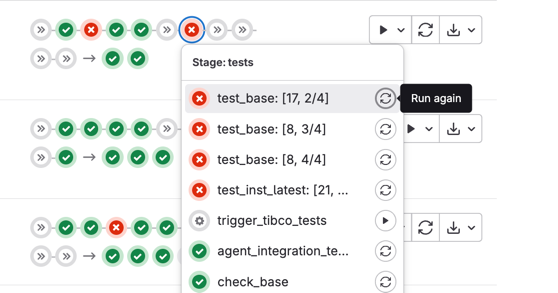
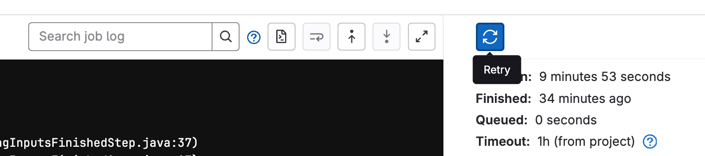

# How to Test

For JUnit test authoring, see the [JUnit testing guide](how_to_test_with_junit.md).
Prefer `@TableTest` for parameterized tests with multi-column literal data. When a simple `@TypeConverter` can turn
table values into the required arguments, prefer it over switching to `@MethodSource`. Use `@MethodSource` for cases
requiring complex object construction, builders, or mocks.

## The Different Types of Tests

The project leverages different types of tests:

1. The most common ones are **unit tests**.  
   They are intended to test a single isolated feature, and rely
   on [JUnit 5 framework](https://junit.org/junit5/docs/current/user-guide/)
   or [Spock 2 framework](https://spockframework.org/spock/docs/).
  * JUnit framework is recommended for most unit tests for its simplicity and performance reasons.
  * Spock framework provides an alternative for more complex test scenarios, or tests that require Groovy Script to
    access data outside their scope limitation (eg private fields).

2. A variant of unit tests is **instrumented tests**.  
   Their purpose is similar to unit tests, but the tested code is instrumented by the java agent
   (`:dd-trace-java:java-agent`) while running.
   They extend the Spock specification `datadog.trace.agent.test.InstrumentationSpecification` which produces traces and
   metrics for testing.
   Instrumentation test harnesses always use strict trace writes so unfinished asynchronous work fails visibly instead
   of producing an incomplete trace.

3. The third type of tests is **Muzzle checks**.  
   Their goal is to check the [Muzzle directives](./how_instrumentations_work.md#muzzle), making sure instrumentations
   are safe to load against specific library versions.
   `coreJdk(version)` and library checks with `javaVersion` fingerprint the selected JDK's major version, vendor, full
   runtime/VM versions, OS, and architecture; `coreJdk()` tracks the Gradle daemon JVM instead.
   Changing these values invalidates cached results even within the same Java major version.

4. The fourth type of tests is **integration tests**.  
   They test features that require a more complex environment setup.
   In order to build such environment, integration tests use Testcontainers to set up the services needed to run the
   tests.

5. The fifth type of test is **smoke tests**.  
   They are dedicated to test the java agent (`:dd-java-agent`) behavior against demo applications to prevent any
   regression. All smoke tests are located into the `:dd-smoke-tests` module.

6. The last type of test is **system tests**.  
   They are intended to test behavior consistency between all the client libraries, and rely
   on [their own GitHub repository](https://github.com/DataDog/system-tests).

> [!TIP]
> Most of the instrumented tests and integration tests are instrumentation tests.

### Forked Tests

Independent of the type of test, test can be run in another (forked) JVM than the one running Gradle.
This behavior is implicit when the test class name is suffixed by `ForkedTest` (eg `SomeFeatureForkedTest`).
This mechanism exists to make sure either java agent state or static data are reset between test runs.

> [!NOTE]
> Forked tests are not run as part of the gradle `test` task.
> In order to run them, you need to use the `forkedTest` task instead.

### Flaky Tests

Mark unreliable test methods or classes with `@Flaky` in both JUnit and Spock.

All tests run by default. Use `-PskipFlakyTests` to skip flaky tests or `-PrunFlakyTests` to run only flaky tests.

If a JUnit test is flaky only in certain environments, use `conditionMethod` to reference a static,
no-argument method that returns `true` when the test is flaky:

```java

@Test
@Flaky(conditionMethod = "datadog.environment.JavaVirtualMachine#isIbm")
void testOnSupportedJvms() {
  // ...
}
```

Use `suites = {"SomeSubclass"}` to limit the annotation to the concrete class executing the test,
such as a subclass that inherits the annotated method. Simple and canonical class names are
supported. Matching is exact, so subclasses and nested classes must each be listed. When both
`suites` and a condition are specified, both must match.

> [!TIP]
> In case your pull request checks failed due to some unexpected flaky tests, you can retry the continuous
> integration pipeline on Gitlab
> * using the `Run again` button from the pipeline view:
    > 
> * using the `Retry` button from the job view:
    > 

### Reproducing timing-sensitive CI failures

Use this workflow when a test intermittently times out, observes incomplete asynchronous work,
or passes locally but fails on a slower CI runner. Agents can invoke `$reproduce-ci-flakiness`
with a CI job URL or a task, test name, and failure log; see the
[repository skill](../.agents/skills/reproduce-ci-flakiness/SKILL.md).

First match the CI commit, Gradle task, test selection, JDK version/vendor, architecture,
dependency suite, and required services. For example, `latestDepTest` may exercise a different
library version, and classes ending in `ForkedTest` require the corresponding forked task.
Preserve CI's exact `-PtestJvm=<selector>` value. Named JVM constraints compare this selector,
so replacing `ORACLE8` with a filesystem path can skip a module that includes only `ORACLE8`,
or bypass a name-based exclusion. Point `JAVA_<selector>_HOME` at the matching local installation
(for example, `JAVA_ORACLE8_HOME=/path/to/oracle8` with `-PtestJvm=ORACLE8`). A filesystem path
is suitable only when the module has no name-based constraints. A local run on another OS or
architecture is a timing experiment, not an exact copy of CI.

#### Choose the timing control

| Control | What changes | Limitations |
|---|---|---|
| `-Xint` | Runs Java bytecode through the interpreter, disabling JIT compilation | Can greatly slow startup and execution; can hide JIT-dependent failures or introduce unrelated timeouts |
| `-XX:ActiveProcessorCount=2` (or `1`) | Changes JVM-visible CPU count and CPU-based pool sizing | Does not cap OS CPU time or restrict threads to that many physical CPUs; check support on the selected JDK/vendor |
| `--max-workers=1 --no-parallel` | Reduces Gradle worker/task concurrency | Does not restrict application threads; reducing build contention may hide the CI failure |
| Container CPU quota or Linux CPU affinity | Restricts actual CPU capacity or eligible CPUs | Requires a suitable environment; record quota/affinity separately from JVM-visible CPU count |

The [Java launcher reference](https://docs.oracle.com/en/java/javase/11/tools/java.html)
describes the JVM flags. When CI CPU starvation is suspected, use an existing Linux/container
test environment with a quota such as Docker `--cpus=1`, or Linux `taskset -c <allowed-cpu>`
around the invocation. Choose a CPU from the process's allowed affinity set. These are separate
experiments; `ActiveProcessorCount=1` alone does not emulate a throttled runner. macOS has no
direct `taskset` equivalent; use a Linux VM/container when actual CPU restriction is needed.

#### Run a narrow comparison

Replace the task, class, JVM selector, and worker count below with the CI values. Set the
corresponding `JAVA_<selector>_HOME` if the JDK needs a local installation override. Preserve
CI's parallelism settings: GitLab's shared arguments use `--parallel --max-workers=$GRADLE_WORKERS`.
Run the baseline once to resolve dependencies and build before adding slowdown flags:

```shell
GRADLE_WORKERS=4 # Replace with the failing CI job's worker count.
./gradlew :path:to:module:test --tests 'package.SomeTest' \
  -PtestJvm=ORACLE8 \
  --rerun-tasks --no-build-cache --no-configuration-cache \
  --no-daemon --parallel --max-workers="$GRADLE_WORKERS" --console=plain --info
```

Then rerun the same command with each command-scoped prefix, first separately and then together:

```shell
JAVA_TOOL_OPTIONS="${JAVA_TOOL_OPTIONS:+$JAVA_TOOL_OPTIONS }-XX:ActiveProcessorCount=2" ./gradlew ...
JAVA_TOOL_OPTIONS="${JAVA_TOOL_OPTIONS:+$JAVA_TOOL_OPTIONS }-Xint" ./gradlew ...
JAVA_TOOL_OPTIONS="${JAVA_TOOL_OPTIONS:+$JAVA_TOOL_OPTIONS }-Xint -XX:ActiveProcessorCount=1" ./gradlew ...
```

Here `...` stands for the complete baseline arguments. Keep baseline and stressed runs' other
settings equal. Test serialized execution separately with `--max-workers=1 --no-parallel`;
it may hide failures caused by contention. If contention between suites matters, also run
the broader CI task selection after trying the narrow reproducer.

[`JAVA_TOOL_OPTIONS`](https://docs.oracle.com/javase/8/docs/technotes/guides/troubleshoot/envvars002.html)
reaches newly launched JVMs that inherit the environment, including test workers and many child
applications. It also affects newly launched Gradle/compiler JVMs, so `-Xint` can slow the build
itself. Keep it scoped to a command, rather than exporting it in shell startup files.
`--no-daemon` avoids reusing a persistent daemon; Gradle can still launch a single-use daemon.
`GRADLE_OPTS`, `JAVA_OPTS`, and `org.gradle.jvmargs` alone do not configure the forked test JVM.

Verify the test worker's output includes `Picked up JAVA_TOOL_OPTIONS` with the intended flags.
If a harness replaces a child application's environment, configure that child's JVM explicitly.
For an effective-value check in the failing JVM, inspect `Runtime.availableProcessors()` and
`ManagementFactory.getRuntimeMXBean().getInputArguments()` using a debugger or temporary diagnostics.
Remove temporary diagnostics after the investigation. Check for explicit task arguments that
override environment-supplied options. For old/vendor JDKs, first try the flags with that JDK's
`java -version`; an unsupported option is a setup failure.

For expensive builds, a temporary Gradle init script can instead add `jvmArgs` to only the
selected `Test` task. Such arguments do not automatically propagate to child application JVMs;
verify them separately. Save this as `/tmp/reproduce-flake.init.gradle`, replacing the task path
and choosing the flags for the current profile:

```groovy
gradle.beforeProject { project ->
  project.tasks.withType(org.gradle.api.tasks.testing.Test).configureEach { testTask ->
    if (testTask.path == ':path:to:module:test') {
      testTask.jvmArgs('-Xint', '-XX:ActiveProcessorCount=1')
    }
  }
}
```

Run the baseline command with `--init-script /tmp/reproduce-flake.init.gradle` and without the
`JAVA_TOOL_OPTIONS` prefix. Check `--info` output for the test worker's command line. Keep
this script outside tracked sources and remove it when finished.

The fresh-execution flags prevent cache hits and up-to-date results from looking like passing
reruns. `--rerun-tasks` also reruns prerequisite tasks, so account for build time. Check the XML
or HTML report to ensure the selected test actually ran. Remove `-PskipFlakyTests` when targeting
an annotated test; add `-PrunFlakyTests` only if you intend to run annotated tests exclusively.
CI enables automatic test retries; preserve the original failed attempt even if a retry passes.

#### Repeat and keep evidence

Start with one attempt per profile. Repeat a promising profile up to ten times within an overall
time budget (for example, 15 minutes); stop at the first failure matching CI or when the budget
expires. Avoid unbounded loops. For a hang, capture thread dumps from the test worker and
relevant child JVMs before stopping the run. Count setup failures and skipped tests separately.

Before another invocation overwrites results, copy the failing log and the module's
`build/test-results/<task>/` and `build/reports/tests/<task>/` directories to a separate location.
Record:

- Commit, task, class/method filter, JDK version/vendor, OS/architecture, and required services.
- Exact command, JVM options, Gradle workers, CPU quota/affinity if any, attempts, failures, and elapsed time per profile.
- First causal exception/assertion, report paths, and whether it matches CI's failure signature.

A timeout introduced only by interpreted execution does not establish the original race.
Passing ten runs does not prove reliability. Use the evidence to inspect missing synchronization,
premature assertions, unfinished cleanup, or incorrect deadlines; do not treat added sleeps,
larger timeouts, or disabling diagnostics as a causal fix. After a fix, check both the profile
that reproduced the failure and normal JIT execution.

## Tests that use containers

> [!IMPORTANT]
> Don't use image name in Test Container constructors like `new CassandraContainer("cassandra:4")`,
> or `new GenericContainer("icr.io/appcafe/websphere-traditional:latest")`. Image tags can change.
> Also, these are not properly tracked as _test_ task inputs and as such can't be fingerprinted.
> Instead, use the `dd-trace-java.testcontainers` plugin to declare these as dependencies,
> it will resolve the actual image digest before running the test.

Declare container images in the module's Gradle build so a changed image cannot
silently reuse cached test results:

```kotlin
import datadog.buildlogic.testcontainers.image

plugins {
  id("dd-trace-java.testcontainers")
}

dependencies {
  testImplementation(libs.testcontainers)
  testImplementation("com.redis.testcontainers:testcontainers-redis:1.6.2")
  testContainerImage(image("redis:7-alpine", "test.redis.image"))
}
```

Use `GenericContainer` or the dedicated container type and use its `DockerImageName` constructor
overload with the relevant system property, **without a fallback value**. The compatibility
declaration is important to let _testcontainer_ know it should accept it as a mirrored image.
For example with Redis:

```java
import com.redis.testcontainers.RedisContainer;
import org.testcontainers.utility.DockerImageName;

DockerImageName image = DockerImageName.parse(System.getProperty("test.redis.image"))
    .asCompatibleSubstituteFor("redis");
RedisContainer redis = new RedisContainer(image);
```

Essentially the plugin resolves tags to immutable registry digests before Gradle checks
whether test results are up to date or cached. Resolution failure stops the test task
earlier, rather than within the tests.

The plugin feed the system property to both `test` and `forkedTest` tasks.

`testContainerImage` is a "companion" for the `testImplementation` configuration.
The plugin automatically creates an image configuration for each `*Implementation`
configuration. For example, `integrationTestImplementation` gets
`integrationTestContainerImage`. Also, see the [plugin reference](../build-logic/testcontainers/README.md)
for inheritance and shared configuration examples.

## Tests that depend on the CI builder image

Apply `dd-trace-java.ci-builder-inputs` when tests depend on the builder image's native
runtime, C headers or tool-specific behavior, such as native profiling or Git pack generation:

```Gradle Kotlin DSL
plugins {
  id("dd-trace-java.ci-builder-inputs")
}
```

## Netty Instrumentation Tests

Instrumentation modules whose tests use Netty 4 or shaded Netty should apply the Netty test convention:

```Gradle
plugins {
  id 'dd-trace-java.module.instrumentation'
  id 'dd-trace-java.instrumentation.netty-concurrent-tests'
}
```

This opt-in convention lives in `build-logic/conventions/src/main/kotlin/` and configures the module
when `dd-trace-java.module.instrumentation` is applied. It adds the `netty-concurrent-4.0`
instrumentation to the test classpath so that Netty tasks captured
by `java-concurrent` can activate and release their context. Additional test suites inherit this
dependency. It does not add a Netty library dependency or change production dependencies.

## Continuation lifecycle failures

Instrumentation test harnesses always enable strict trace writes; there is no harness opt-out.
Do not replace the harness tracer or introduce another way to disable strict writes.

Fix continuation leaks when possible.
If a fix cannot be included immediately, quarantine the Spock test with `@Flaky` and a useful reason or tracked issue so
the failure remains visible.
`@Flaky` is not yet supported for JUnit tests.
Keep continuation tracking enabled so the diagnostic evidence is preserved.

`@TrackScopeContinuations` records every detected lifecycle condition by default. Use `disabledChecks`
to exclude checks from enforcement:

```java
// Exclude an enforced check only for a proven diagnostic incompatibility.
@TrackScopeContinuations(
    disabledChecks = ScopeDiagnosticsCheck.ACTIVATE_AFTER_RESOLVE,
    reason = "the synthetic fixture models failed activation without a real continuation; remove with ABC-123")
```

An empty `disabledChecks` list keeps all checks active, including checks added in the future. A
nonempty list excludes only the listed checks and includes future checks automatically. A method
annotation replaces the class configuration; exclusion lists are not merged.

`enabled = false` stops recording entirely and requires an empty `disabledChecks` list. A reason is
required whenever `enabled = false` or `disabledChecks` is nonempty. Document the incompatibility
and its removal condition.

With recording enabled, all conditions remain recorded and reported even when every check is
excluded. Excluding checks changes enforcement only; it does not disable recording, classification,
or the bounded wait for asynchronous cleanup.

The diagnostic policy determines which findings fail a test and which are advisory. Excluding a
check affects enforcement without removing its diagnostic evidence. Reports distinguish findings
that caused a failure from those retained for context.

Disable recording or individual checks only for a proven incompatibility with the diagnostic itself,
never to hide an unresolved lifecycle bug.
Strict trace writes remain enabled.

## Running Tests

You can run the whole project test suite using `./gradlew test` but expect it to take a certain time.
Instead, you can run tests for a specific module (ex. `:dd-java-agent:instrumentation:opentelemetry:opentelemetry-1.4`)
using the test command for this module only:
`./gradlew :dd-java-agent:instrumentation:opentelemetry:opentelemetry-1.4:test`.

> [!TIP]
> Flaky tests can be disabled by setting the Gradle property `skipFlakyTests` (ex. `./gradlew -PskipFlakyTests <task>`).

### Running Tests on Another JVM

To run tests on a different JVM than the one used for the build, you can specify it using the `-PtestJvm=` command line
option to the Gradle task:

* `-PtestJvm=X` like `-PtestJvm=8`, `-PtestJvm=25` to run with a specific JDK version,
* `-PtestJvm=/path/to/jdk` to run with a given JDK,

To also run CI tests on the additional vendor and pre-release JVMs, include the case-sensitive
`[ci: NON_DEFAULT_JVMS]` option in the commit message. By default, CI runs amd64 tests only.

On pull requests, arm64 tests are manual jobs. To run them on CI, include one of the following case-sensitive
texts in the commit message:

* `[ci: ARM64]` to run them on the default arm64 JVMs.
* `[ci: ARM64, NON_DEFAULT_JVMS]` to run them on all eligible JVMs.
* `[ci: ARM64, JAVA11]` to add Java 11 to the default arm64 JVMs.
* `[ci: ARM64, NON_DEFAULT_JVMS, JAVA11]` to also include Java 11 vendor JVMs (Zulu and Semeru).

### Running System Tests

The system tests are setup to run on continuous integration (CI) as pull request check
using [a dedicated workflow]((https://github.com/DataDog/system-tests/blob/main/.github/workflows/system-tests.yml)).
To run them locally, grab a local copy of [the system tests](https://github.com/DataDog/system-tests) and run them from
there.
You can make them use your development version of `dd-trace-java` by [dropping the built artifacts to the
`/binaries` folder](https://github.com/DataDog/system-tests/blob/main/docs/execute/binaries.md#java-library) of your
local copy of the system tests.

### The APM test agent

The APM test agent emulates the APM endpoints of the Datadog Agent.
The APM Test Agent container runs alongside Java tracer Instrumentation Tests in CI,
handling all traces during test runs and performing a number of `Trace Checks`.
Trace Check results are returned within the `Get APM Test Agent Trace Check Results` step for all instrumentation test
jobs.
Check [trace invariant checks](https://github.com/DataDog/dd-apm-test-agent#trace-invariant-checks) for more
information.

The APM Test Agent also emits helpful logging, including logging received traces' headers, spans, errors encountered,
and information on trace checks being performed.

Logs can be viewed in GitLab within the Test-Agent container step for all instrumentation test suites, e.g. the
`test_inst` jobs.
Read more about [the APM Test Agent](https://github.com/datadog/dd-apm-test-agent#readme).

### Forwarding CI Test Logs to Datadog

Test output remains available in GitLab job artifacts. To also forward JUnit-captured output to Datadog, include the
case-sensitive `[ci: DEBUG_LOGS]` option in the commit message or set the GitLab CI variable
`DD_CIVISIBILITY_LOGS_ENABLED=true`.
You can combine it with other CI options, for example `[ci: ARM64, DEBUG_LOGS]`.

The opt-in forwards all JUnit-captured output, not only DEBUG messages.
